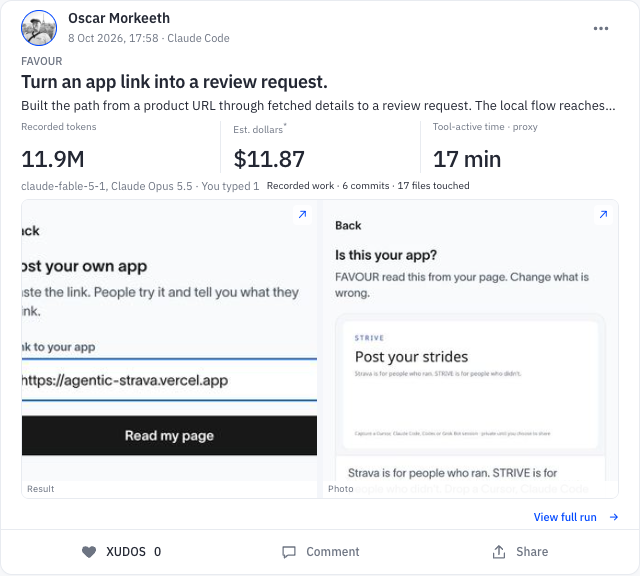

# STRIVE

STRIVE turns a recorded coding-agent session into a visual run you can save privately and share when you choose. Capture needs no model API key.

**[Open STRIVE](https://striverun.app)** · [Contribute](CONTRIBUTING.md)

_Captured from [the public FAVOUR run](https://striverun.app/?run=47e8f731-a4a3-44ce-add2-63fa6e815af5) on 11 October 2026._

## Make your first private run

1. **Choose a recorded session.** Open [STRIVE](https://striverun.app/?post) and use the [capture instructions](https://striverun.app/agents.md) with your coding agent, or select a supported export on your own computer. Confirm the project and session before import.
2. **Review the preview.** Check the source-backed measurements, write your own title and story, and add a screenshot of the work if you have one. A preview is not a saved run.
3. **Save as Only me.** Sign in, choose **Only me**, save, then open the run again to check the result. You can change its audience later if you want to share it.

The capture stays on your machine until you deliberately save a run. Missing measurements stay unknown. A saved private run is visible only to its owner. [Privacy and photo details](PRIVACY.md) · [How capture works](docs/CAPTURE-AND-INTEGRATIONS.md)

## Build with us

STRIVE is free and open source. Help with a first-run problem, a card, accessibility, or a clear bug report. [Start contributing](CONTRIBUTING.md) · [First contributions](docs/FIRST-PR.md) · [Product direction](PRODUCT.md) · [Get help](SUPPORT.md) · [Report a security issue](SECURITY.md).

The public app is at [striverun.app](https://striverun.app). The [full contributor setup](CONTRIBUTING.md) uses a local static UI; it does not reproduce the hosted account or database. Historical Agent Grinder material is kept in [the technical history](docs/TECHNICAL-HISTORY.md) and [archive](archive/hackathon-2026-09/).
