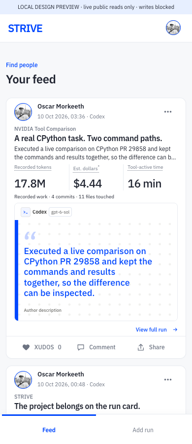
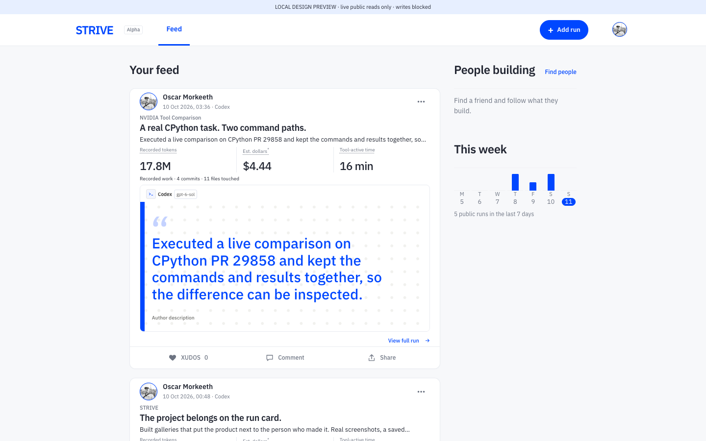

# Feed load stability

The first sign-in event and provider discovery could each trigger a full route render. The fix coalesces identity restoration, runs provider discovery independently, reserves the header and loading layout, and keeps the first count-up frame populated. Photo cards begin with a reserved neutral area; a no-image card shows its authored tile and one harness/model chip.

People building excludes the viewer at read/render time. Its follow control independently rejects self actions, including a changed identity while the relation read is in flight. Builder names occupy a full column, with controls below.

## Before and after

Chrome performance traces use the same frozen real public responses, a controlled cached user, a 160 ms profile restore and a 2.5 second provider-discovery delay. No real credential is exported, no private run is read, and no write is sent. This is a reproducible browser regression measurement, not production account telemetry.

| Viewport | CLS before | CLS after | Tracked visible state changes before / after | Full feed paints before / after |
| --- | --- | --- | --- | --- |
| 390 × 900 | 0.11200 | 0.00017 | 12 / 9 | 2 / 1 |
| 1440 × 900 | 0.03638 | 0.00011 | 17 / 9 | 2 / 1 |

State changes sample header, heading, card count and bounds, media type, activity bars, and People building once per animation frame. These counts are not GPU paint totals. The bounded trace includes ordinary loading steps; the old feed begins a second render inside the observation window. After the fix, it never clears completed cards. Four quote-to-photo replacements become four neutral-placeholder-to-photo arrivals. Feed activity bars are absent in both versions, as intended; the detail view retains them.

A signed-in live Chrome read confirmed the duplicate chip and the settled account/feed state. A desktop screen recording was rejected because another app came to the foreground. It is not included in these results. Hosted signed-in reload remains a release check for Fable.

## Checks and limits

`test-feed-stability.mjs` exercises the actual startup coordinator, expired/blocked cached hints, real animation module, real self-follow control, and card renderer. It is included in `test:sunday`. Sunday and launch suites pass locally. Photo permission and known-id byte checks remain in place; media counts are presentation hints, and mounting still performs a fresh authorized read. Resolving metadata before painting adds a small list-read round trip; image authorization is not cached away.

No migration, production data, visibility, estimate flag, or PR128 changes. The cached-session hint only chooses the loading appearance; verified session/profile restoration still controls every authenticated view and action.
