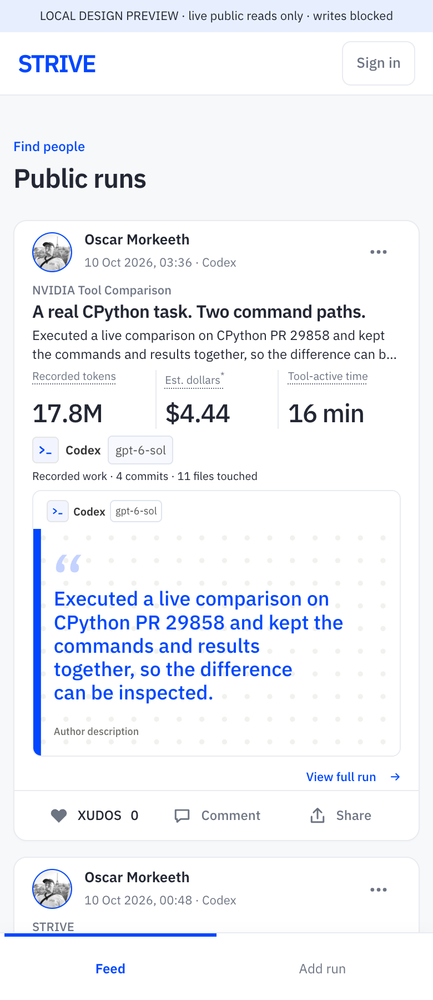
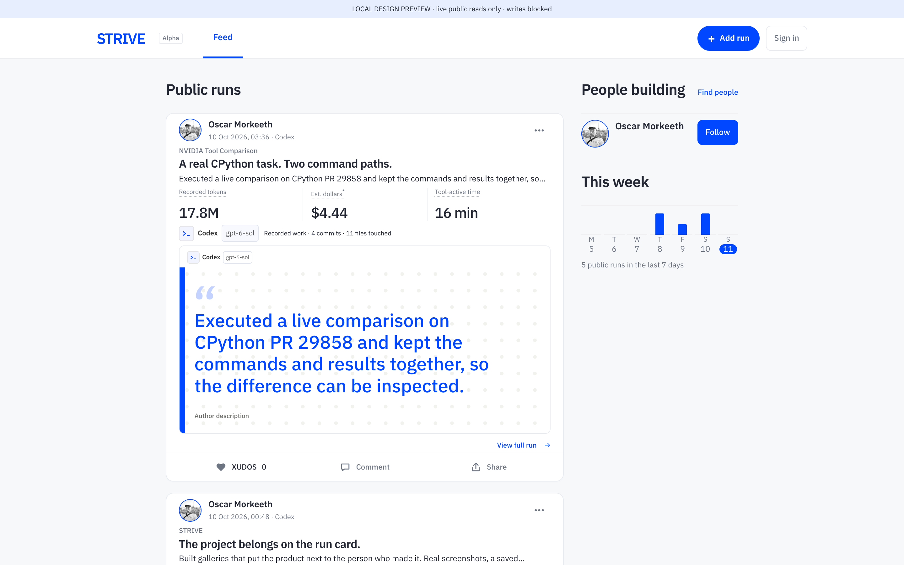
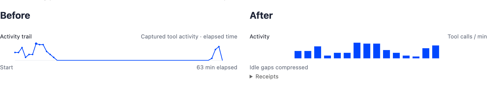

# Recorded work, readable cards, deliberate photo sharing

Dropped native session files now use the same recorded usage, price snapshot and occupied-minute inputs as the plugin. Three headline positions explain their meaning when tapped; measured activity becomes bars with idle gaps compressed, while sparse or untimed captures stay as honest counts. Images retain a saved order, and sharing one personal photo is an explicit choice independent of its position.

## Visual proof

These screenshots show the local build using public production rows, read-only, on 11 October 2026. Chrome viewport readback equals document width at 390 and 1440; device scale is 2. Existing project/photo content is unchanged by this PR.

The activity comparison uses the same public run, 930b058b-733c-4f1e-bd6e-691d8ef09271, with the prior main renderer pinned to 160240ef and this branch. Bar heights are tool calls divided by each stored window duration, not exact per-minute timestamp bins. The disclosure gives the window size; sparse and call-index-only records receive no invented graph.

## Verification

- `npm run test:sunday`: capture parity, real view path, gallery privacy, staged editor save/reload, owner/other/anonymous SQL permission tests, migration retry/rollback, activity source limits.
- `npm run test:launch` and `npm run test:cards`.
- Python estimate tests: seven passed.
- A real native Codex file selected in Chrome produced the same tokens, estimated dollars and tool-active minutes as the plugin. This was a private local preview, with no hosted save or source path sent. The receipt and sparse Cursor comparison remain private.
- Actual editor preview: 21 visible controls with two project images, at both viewports. Marking an image personal exposes the separate public-sharing toggle, initially off; reordering leaves it off. Local preview writes are blocked.

## Release boundary

Apply reviewed migration 037 before the matching API/web deployment. See [migration and rollback review](MIGRATION-REVIEW.md). No production data, visibility, photo bytes, or estimate flag was changed by this branch. The release owner still must verify deployed owner save/reload and signed-out known-id denial after explicit personal-consent withdrawal. Old asset replacement is separate.
