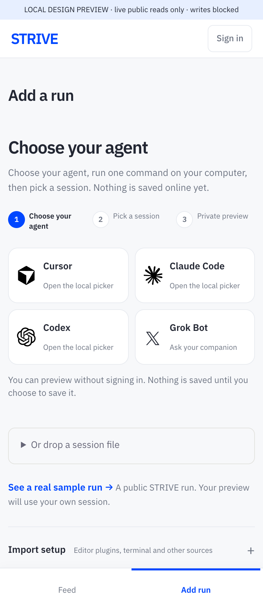
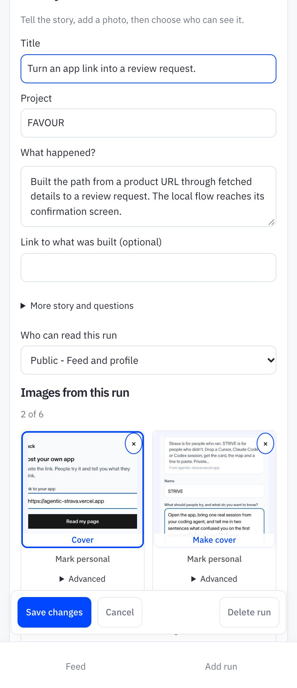
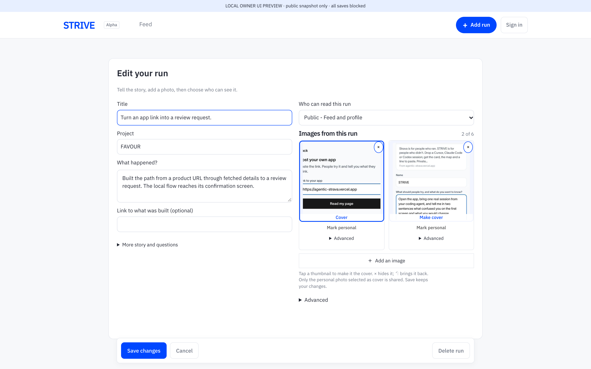

# Add run and image editor — 11 October 2026

Choose your agent, open a local recent-session list, and preview the selected sitting before signing in. Images now have cover, reversible hide and personal controls; roles and lead-image options sit under Advanced. Changes stay staged until Save, and Cancel makes no hosted writes.

These screenshots show the isolated preview at 390 × 900 and 1440 × 900, Chrome at 2×. The editor uses the existing public FAVOUR form run; the local owner-preview switch blocks every hosted write. They contain no private capture or session prompt.

## Verification

- Real native Codex file, separate clean HOME: local picker → canonical anonymous import preview. No first prompt in payload; measurement revision and estimate inputs preserved. Nothing saved online.
- Both viewports: document width equals viewport; all three import steps fit; two-image editor has 18 visible form controls (including disclosures and Save/Cancel/Delete), with roles and lead choices collapsed.
- Cover, hide/restore, personal toggle, full-size image viewer, then Cancel: no hosted write.
- Source picker rejects other origins and null origins; child Codex sessions excluded; prompt escaped and kept local.
- Sunday, launch and card checks pass. Current live quote tile fills its media region: 590px at desktop and 330px at phone.

## Scope kept for follow-up

The current picker captures the latest sitting and retains the existing 64 MiB source limit. Streaming long sources, full sitting selection, Windows adapters and the no-uv path are follow-up work. Estimate rendering/import parity, manual image order and activity chart changes are a separate slice; this PR does not change those facts or any production data.
