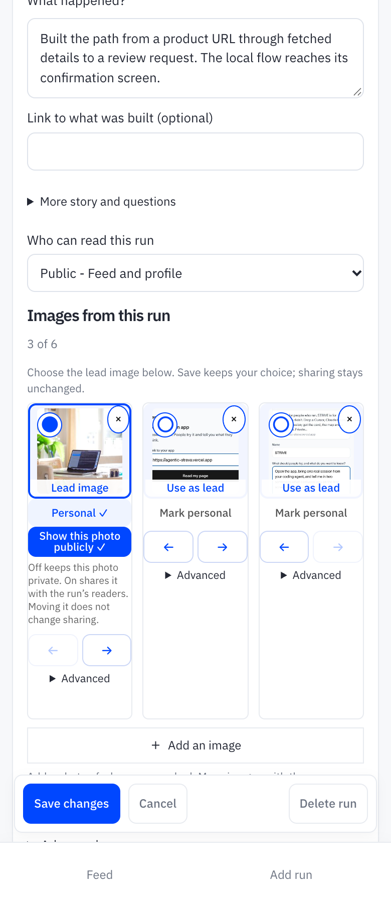
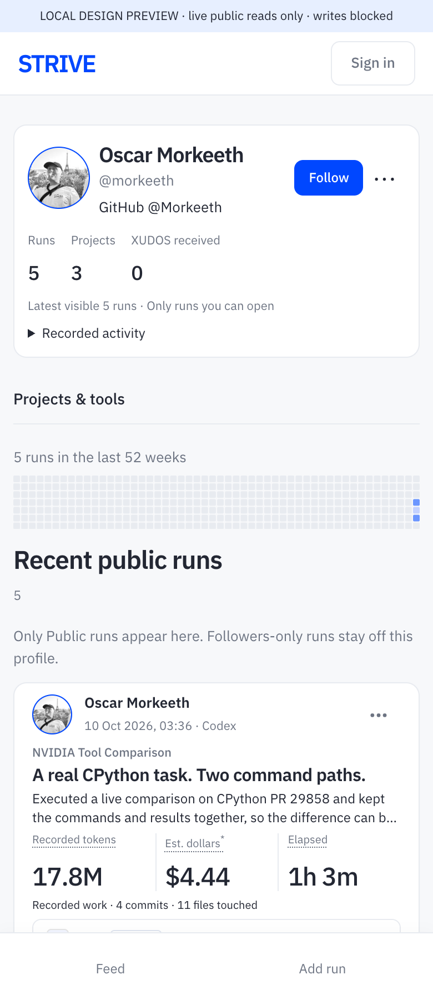

# Visual lead choice, elapsed time, profile header

The actual image thumbnails now form one keyboard-accessible lead-image choice. Save persists their order through the existing owner API; choosing a lead does not grant personal-photo sharing or restore a hidden image. The obsolete cover/result/before-after text radios are removed; existing legacy layout values are left intact.

Cards and details now show captured elapsed time rather than an occupied-minute count. Validated source timestamps supply elapsed time when available; existing recorded duration fields remain the fallback. The ODAWG source window is 40.472 seconds across two clock minutes: the card says **Elapsed / 40 sec**, while measurement details explain **2 occupied clock minutes**. Cost calculations and stored evidence are unchanged.

The profile uses one header with compact Runs / Projects / XUDOS totals, Follow beside the name, and Block in a three-dot menu. Recorded usage is available in a disclosure; absent dollars and active time are not displayed as large totals.

## Verification

- `npm run test:sunday` and `npm run test:cards` passed on Node 22.
- Four readable images plus unconsented personal/hidden-project inputs: actual client mount and public HTML both keep the first three saved positions, including a personal lead; +1 and the full viewer preserve the remaining image. Both regressions failed on the previous renderer before the fix.
- Actual thumbnail → Save → API → disposable PostgreSQL → reload: exactly one lead persists; an unconsented personal image remains denied by known id. Keyboard arrow selection retains focus and stays staged until Save.
- Real Chrome, 390×900 and 1440×900 at 2×: real public FAVOUR image bytes, one selected thumbnail, zero old layout radios, no browser errors or horizontal overflow.
- Profile: real signed-out public reads; a separate controlled other-viewer case exercises the actual Follow/Block component. The latter uses local read fixtures, not an authenticated production session.
- Public-data screenshots below are local previews. Browser Save is blocked; persistence was verified against disposable PostgreSQL. Production deployment and authenticated owner save/reload remain the coordinator's release gate.

